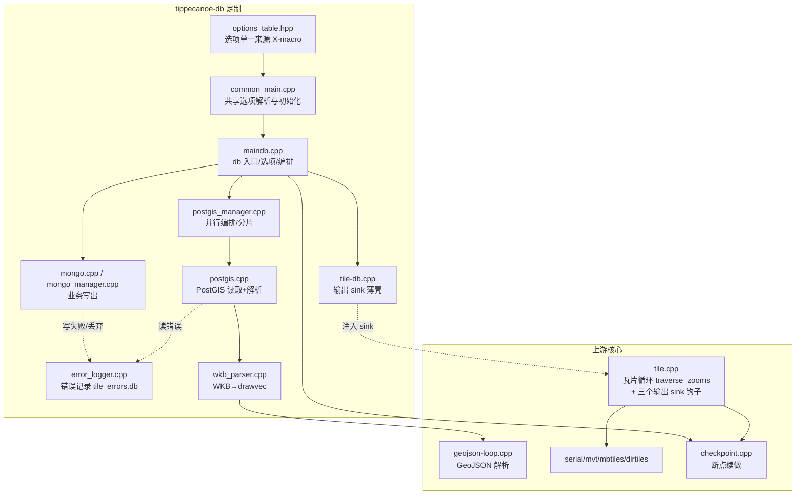
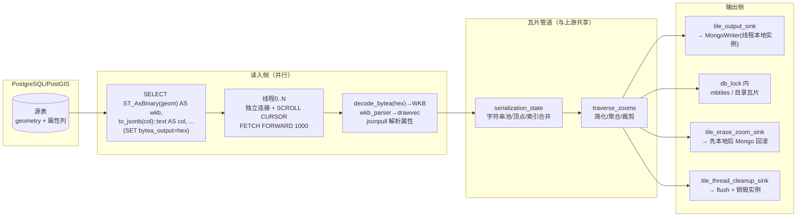
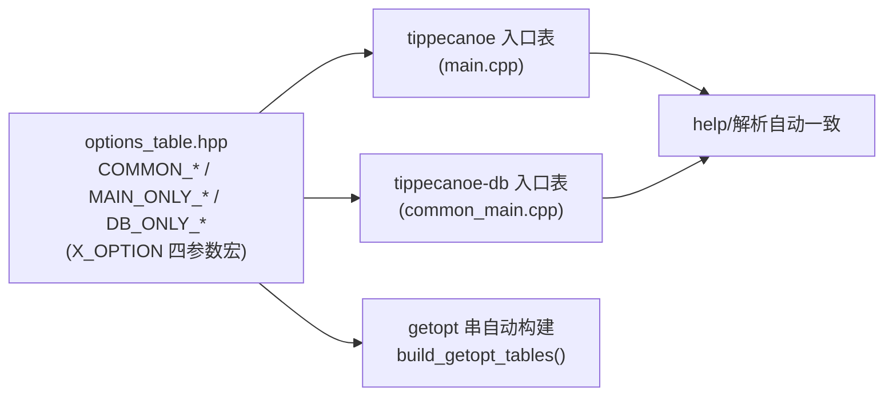
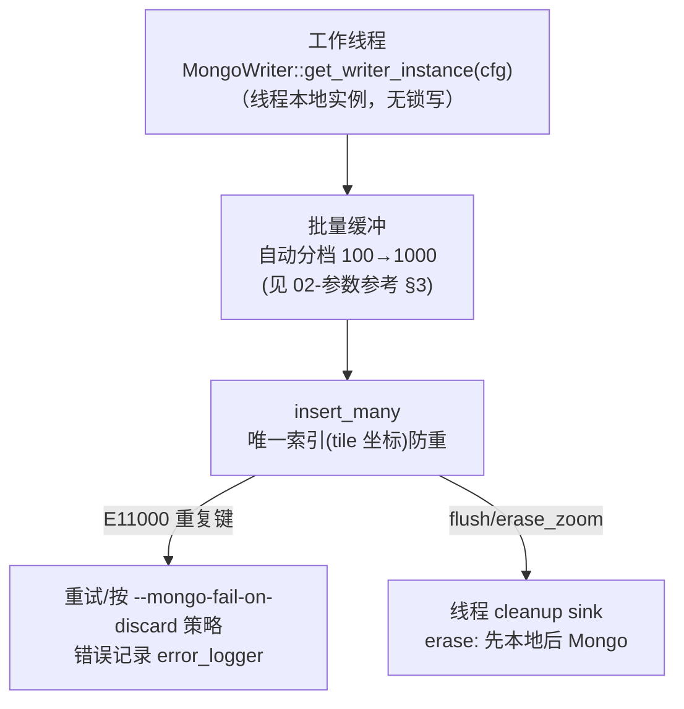

# 03 架构设计

> 面向维护者。所有结构与本文一致处以源码为准：
> 入口 [maindb.cpp](../../maindb.cpp)、读取 [postgis.cpp](../../postgis.cpp)/[postgis_manager.cpp](../../postgis_manager.cpp)、
> 业务输出 [mongo.cpp](../../mongo.cpp)、瓦片管道 [tile.cpp](../../tile.cpp)、
> db 注入层 [tile-db.cpp](../../tile-db.cpp)、断点续做 [checkpoint.cpp](../../checkpoint.cpp)、
> 选项单一来源 [options_table.hpp](../../options_table.hpp)。

## 1. 模块关系



## 2. 数据流（双输出模式）



要点：
- **读入并行、写出分两条腿**：PG 侧每线程独立连接分批拉取（hex 文本→WKB→drawvec），
  与 GeoJSON 路径在 `geojson-loop` 之后的 serialization_state 完全汇合——这是
  "db 与 GeoJSON 瓦片输出可逐字节一致"（china 基准）的结构基础。
- **写出顺序契约**（[tile-db.cpp](../../tile-db.cpp)）：每瓦片 sink（Mongo 先、本地后且本地在
  `db_lock` 内）；zoom 回滚 sink（本地先、Mongo 后）；线程收尾 sink（flush/销毁）。
  三个钩子默认 NULL，tippecanoe 主程序路径零开销。

## 3. 输出 sink 机制（上游 tile.cpp 的最小侵入）

[tile.cpp](../../tile.cpp#L60-L62) 定义三个函数指针：

```cpp
void (*tile_output_sink)(int z, unsigned tx, unsigned ty, const std::string &compressed) = NULL;
void (*tile_erase_zoom_sink)(int z) = NULL;
void (*tile_thread_cleanup_sink)() = NULL;
```

- [tile-db.cpp](../../tile-db.cpp) 是唯一注入者（v3.4 副本收敛后仅 78 行薄壳），
  `set_tile_db_output_sinks()` 在 maindb 启动时调用。
- 上游语义不受影响：sink 为 NULL 时瓦片循环与原版逐行等价（make test 全绿为证）。
- 能力禁用：tippecanoe-db 调用 traverse_zooms 传 `session=NULL`、`drop_by_attribute=NULL/false`，
  checkpoint 的部分能力路径不进入；mbtiles `metadata.name` 规范等行为由 maindb 侧控制。

## 4. 关键机制

### 4.1 选项单一来源（消除 108 项双表复制债）



新增通用选项只在 `COMMON_*` 组加一行，两个入口的 getopt 表、help 输出自动同步；
`unit` 的表一致性测试（make unit）防止漂移。

### 4.2 Mongo 写出



- 线程本地 writer 实例避免跨线程争用；`destroy_current_thread_instance()` 在收尾 sink 中调用。
- 集合上的瓦片坐标唯一索引保证重跑幂等（重复写触发 E11000，按策略处理）。

### 4.3 PostGIS 读取与 OOM 防护

- cursor 模式（默认）：`BEGIN` → `DECLARE ... SCROLL CURSOR` → 循环
  `FETCH FORWARD 1000`，批间在多线程间二次均衡；
- 非 cursor（单批物化）仅在行数 ≤ batch_size 时允许；`--postgis-sql` 大表且无
  分片键时直接拒绝并提示（历史缺陷 DB-S5 的防护，防止静默物化 OOM）；
- 分片：`--postgis-shard-key` + `hash/range`（服务器端过滤，消除线程空转）。

### 4.4 断点续做（两入口共用）

状态机与操作详见 [04-断点续做](04-断点续做.md)。tippecanoe-db 侧增加
"读入阶段快照"（entry snapshot）：仅当 entry snapshot 完成后才允许定点恢复，
读入阶段 SIGTERM 直接退出 110 不留快照（M13 时序语义）。

## 5. 对上游文件的修改清单（合并基线视角）

| 上游文件 | 修改 | 目的 |
|---|---|---|
| `tile.cpp` | 三个 sink 钩子声明 + 循环内调用点（write/erase/cleanup） | 输出注入，见 §3 |
| `main.cpp` | 接入 checkpoint（checkpoint-dir/resume/status/prune 等选项） | 断点续做 |
| `geojson-loop.cpp` / `read_json.cpp` | 读入阶段可被 checkpoint 中断点检查 | 断点续做 |
| `Makefile` | vendor 优先/回退；tippecanoe-db 目标链接 tile.o/checkpoint.o/pmtiles_file.o；unit 目标参数化 | 构建体系 |
| `projection.*` / `decode` / `tile-join` | M15 反投影跟随输出网格、crs 感知 | 上游语义修复（回归见 tests/qa/run_m15.sh） |
| `README.md` 等上游文档 | **不改**（保持与上游一致） | 文档策略 |

其余全部为新增文件（tippecanoe-db 域 + third_party + docs/customization）。
