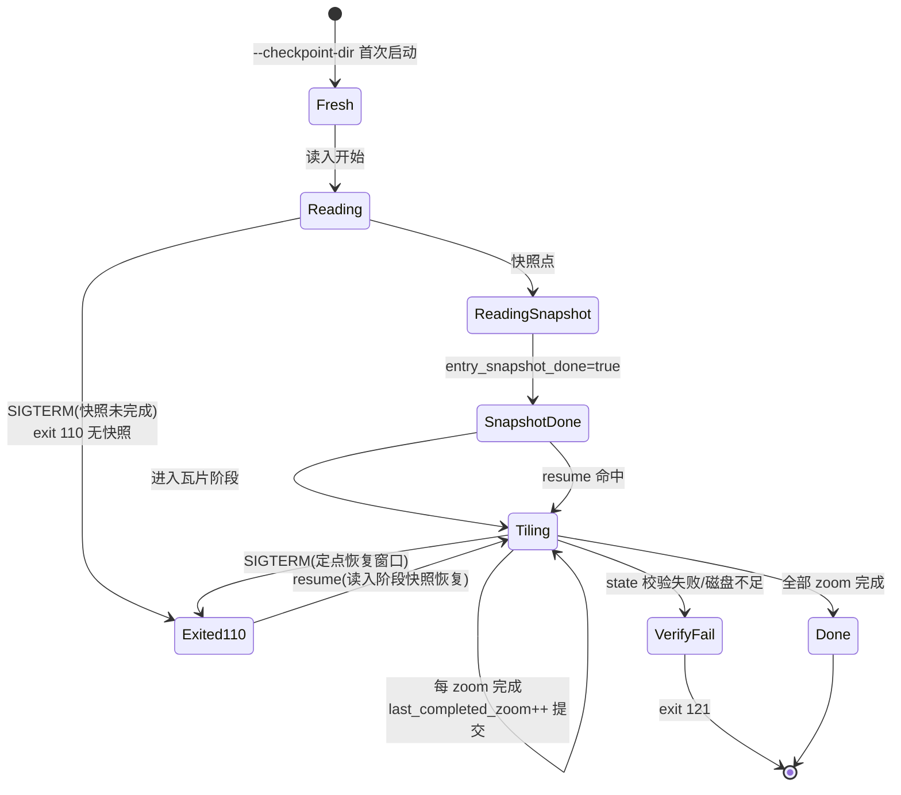

# 04 断点续做（checkpoint / resume）

> 适用：`tippecanoe`（上游流程 + 定制 checkpoint）与 `tippecanoe-db`（PostGIS 输入 + 业务输出）。
> 历史设计稿与测试报告见 [history/](history/)（文件读取阶段断点续传设计方案、断点续做说明文档、
> 断点续做测试报告）；本文为当前态。

## 1. 功能分层

| 层 | 覆盖阶段 | 机制 |
|---|---|---|
| 瓦片阶段 checkpoint | 读入完成后的逐 zoom 生成/写出 | 每完成一个 zoom 提交一次 `state.json`（原子替换）+ 阶段产物 |
| 读入阶段快照（entry snapshot） | 读入/解析阶段 | 定点快照 serialization 状态（字符串池/顶点/索引）；快照完成前不可定点恢复 |
| tippecanoe-db 专有 | 读入 + 瓦片两段 | entry snapshot 完成后才可从中断点恢复；未完成时 SIGTERM 直接退出 110 不留快照（M13 时序语义，避免半快照） |

## 2. 状态机



## 3. 操作流程

```bash
# 首次启动（绑定 checkpoint 目录）
tippecanoe --checkpoint-dir=/data/ckpt/job1 -f -Z0 -z12 -o out.mbtiles in.geojson

# 中断（SIGTERM）后恢复：同参数 + resume
tippecanoe --checkpoint-dir=/data/ckpt/job1 --resume -f -Z0 -z12 -o out.mbtiles in.geojson

# 查看状态（不执行）
tippecanoe --checkpoint-dir=/data/ckpt/job1 --checkpoint-status

# 清理过期快照（保留最近 N 个 zoom 级别的可恢复点）
tippecanoe --checkpoint-dir=/data/ckpt/job1 --checkpoint-prune

# 强制覆盖已存在 checkpoint 的同名任务
tippecanoe --checkpoint-dir=/data/ckpt/job1 --checkpoint-force ...
```

tippecanoe-db 的用法相同（选项同表，见 02-参数参考），恢复时同样要求
参数与首次一致（不一致按 121 校验失败处理）。

## 4. 关键语义与约束

- **机器绑定**：checkpoint 绑定创建它的机器（主机指纹校验），跨机器恢复拒绝。
- **两阶段定点恢复**：恢复入口先等 `state.json.tiling.entry_snapshot_done == true`，
  再等首个 `last_completed_zoom >= 0`——避免恢复到半快照
  （tests/qa/run_p2.sh 的 `wait_zoom_committed` 即该语义的回归实现）。
- **state.json 完整性**：tiling 字段被篡改会被校验拦截（M5），blob 截断同样拦截（M6/M7）。
- **SIGTERM 语义（M13）**：读入阶段（快照未完成）→ 直接退出 110、无快照；
  快照完成后 → 定点恢复窗口。
- **metadata 一致性（M1/db M13 同源）**：恢复/重跑时 mbtiles metadata name 与首次一致，
  不含绝对路径噪声。

## 5. 退出码（checkpoint 相关）

| 码 | 语义 |
|---|---|
| 110 | 读入阶段 SIGTERM（无快照）/ EXIT_NODATA 语义位 |
| 121 | checkpoint 数据校验失败或磁盘空间不足（EXIT_CHECKPOINT） |
| 122 | Mongo 失败（tippecanoe-db） |

## 6. 回归覆盖

- `tests/qa/run_p2.sh`：R1 等价性（ckpt+resume vs oneshot 输出一致）、R3 初快照退出码、
  R4 冲突检查前移、R5 state 篡改拦截、R6/R7 blob 截断与 SIGTERM 时序、R8 高位字节 name 往返。
- 基线：PASS=12 FAIL=0（2026-10-17，feature/combined @ vendor 化后）。
